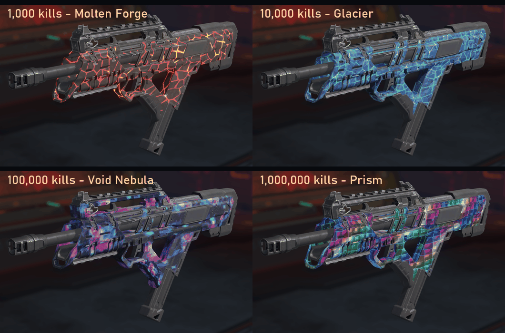

# Resurge Whiteout

<div align="center">


[](https://www.gnu.org/licenses/gpl-3.0)


**A launcher for the Microsoft Store (GDK) version of Call of Duty: Black Ops III, built on Resurge.**

[**Download the latest release**](../../releases/latest) · [العربية](README-ar.md)

</div>

---

## Download and play

1. Go to [Releases](../../releases/latest) and download **`Resurge.Whiteout.2.7.Windows.x64.zip`**.
2. Extract it anywhere and run **`Resurge Whiteout.exe`**.
3. On first start the launcher looks for your game folder and for `Resurge.dll` (from the original Resurge launcher) by itself. If it can't find them, pick them on the **Play** page.
4. Press **Play**.

From 2.7 on, the launcher updates itself: when a new version is out, an **Update available** box appears on the **Play** page.

The release also has **`T7InternalWS.dll`**, the Whiteout runtime, as a separate download. You don't need it to play, because the launcher already contains it. It's there for anyone who wants to use the runtime directly.

## Features

- **Zombies:** all DLC maps online (Solo and Private Game), Dark Matter / Gold / Diamond camos, four animated **mastery camos** unlocked by total zombie kills (1K / 10K / 100K / 1M)
- **Multiplayer:** level 1000
- **Friends:** add friends, live chat, online status, profiles with About Me, pop-up notifications
- **Workshop:** search, paste a Steam link, install and uninstall maps and mods
- **Graphics:** Max FPS / Balanced / Best Looks presets, FPS cap, render scale, FOV, display mode
- **Controller:** remap buttons, PS5 DualSense support without DS4Windows
- **In-app updater**

<p align="center"></p>

## Requirements

- Windows 10/11, 64-bit
- A legitimate copy of **Call of Duty: Black Ops III** (Microsoft Store)
- `Resurge.dll` from the original Resurge launcher

## Legal

This project does **not** include any game files. Call of Duty: Black Ops III but you can get it in fitgirl or anywhere or use steam version 
## Building from source

Requirements: Visual Studio 2026 (C++ desktop workload, v145 toolset) and the .NET 8 SDK.

- `resurge_portable_source/`: the WPF launcher (.NET 8)
- `resurge_source/`: the native runtime `T7InternalWS.dll`
- `friends/`: Supabase SQL for the Friends and updater backend

The native build expects the Windows SDK x64 libraries and the Steamworks SDK in a local `_deps/` folder, with an `_deps/x64libs.props` that points at them. These aren't in the repo because they aren't ours to redistribute. With those in place:

```powershell
.\build.ps1                       # native DLL + single-file launcher in _out
.\build.ps1 -Package -Version 2.7 # also makes the release folder and zip on the Desktop
```

To build only the launcher (it uses the prebuilt `resurge_portable_source/Assets/WhiteoutGdkRuntime.dll`):

```powershell
dotnet publish resurge_portable_source/ResurgeLauncherCSharp.csproj -c Release -r win-x64 --self-contained true -p:PublishSingleFile=true
```

## Credits

Resurge Whiteout is based on **Resurge** and on the work of these projects:

- **[BO3Enhanced](https://github.com/shiversoftdev/BO3Enhanced)** by shiversoftdev: MS Store client enhancements
- **[boiii-free](https://github.com/Ezz-lol/boiii-free)** by Ezzboiii: boiii client
- **[BOIII-ReImagined](https://github.com/BiraruStudios/BOIII-ReImagined)** by BiraruStudios
- **[GSCs](https://github.com/ZombossXD/)** by Nightwalker

Third-party licenses are in [`Licenses/`](Licenses).

## License

[GNU General Public License v3.0](LICENSE)
